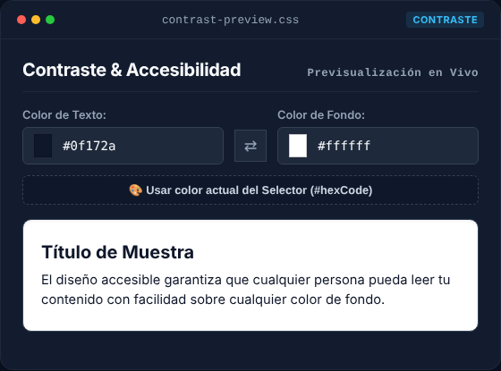
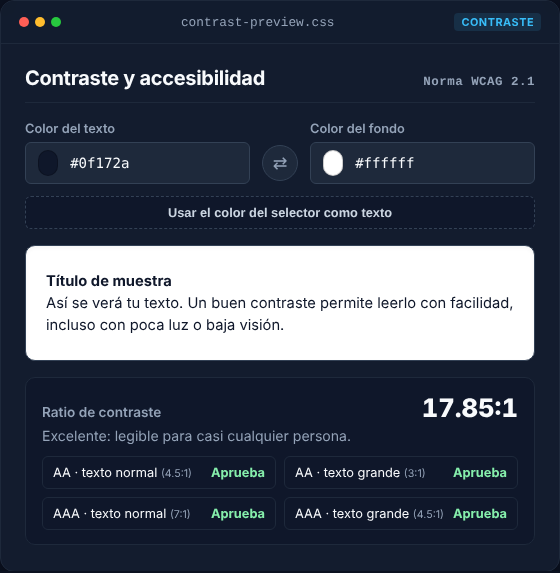
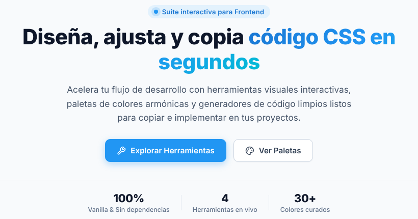
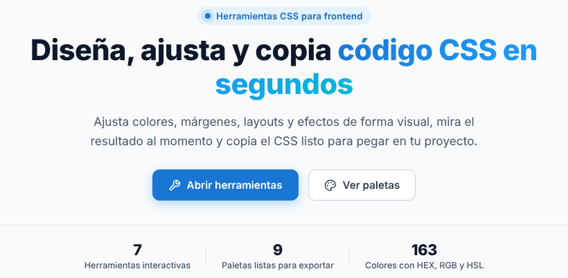
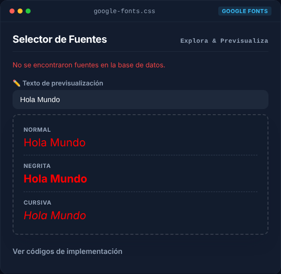
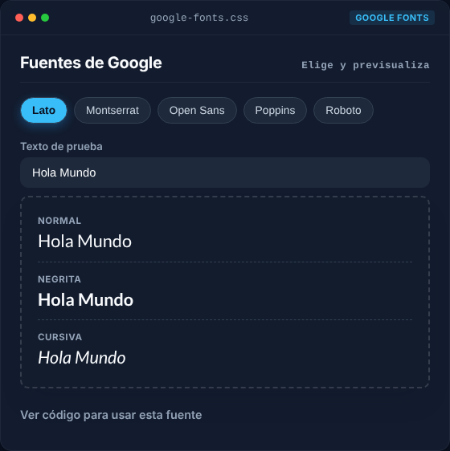

# Auditoría de CSS Helper

**Proyecto auditado:** [JulianPeralta26/CssHelper](https://github.com/JulianPeralta26/CssHelper) (commit `0361607`)
**Dónde están las correcciones:** en este repositorio (`edhdez1/Pruebas`), no en el de Julian. El primer commit es una copia exacta del original; los siguientes contienen las correcciones, así se puede ver cada cambio por separado.
**Fecha:** 11 de noviembre de 2026

---

## Resumen en una frase

La app se veía bien y tenía buena base, pero **4 herramientas no funcionaban del todo** (fuentes, contraste, selector de color en modo oscuro y en móvil), **80 textos no se leían bien por falta de contraste** y **la página de inicio mostraba cifras falsas**. Todo eso quedó corregido sin cambiar la identidad visual.

## Cómo se revisó

| Revisión | Herramienta | Antes | Después |
|---|---|---|---|
| Prueba automática de botones y herramientas (clic, copiar, arrastrar, teclado, móvil) | Playwright, 60 comprobaciones en modo claro y oscuro | 47 de 58 bien | **60 de 60 bien** |
| Accesibilidad (contraste, etiquetas, títulos) | axe-core, norma WCAG 2.1 AA | 110 avisos (80 de contraste) en 4 páginas | **2 avisos** (ver "Lo que no se cambió") |
| Errores de código | `php -l` y `node --check` en todos los archivos | sin errores de sintaxis | sin errores de sintaxis |

Guías usadas como criterio: *frontend-design* (Anthropic), *frontend-a11y* (ECC) y el método *superpowers* (entender, planificar y verificar antes de entregar).

---

## 1. Lo que no funcionaba (errores)

| # | Problema | Qué veía la persona usuaria | Arreglo |
|---|---|---|---|
| 1 | **Fuentes sin MySQL** | Si MySQL no estaba encendido, el selector de fuentes mostraba "No se encontraron fuentes" y quedaba inútil | La app ahora usa una lista de respaldo con las 5 fuentes. Con MySQL sigue funcionando igual que antes |
| 2 | **El verificador de contraste no verificaba nada** | El README prometía el ratio WCAG, pero solo había una vista previa | Calcula el ratio real (por ejemplo, 4.47:1) y dice si aprueba AA y AAA para texto normal y grande |
| 3 | **Círculo de color oscuro en modo oscuro** | Elegías rojo y el círculo de muestra se veía azul marino | Una regla con `!important` lo pintaba. Se quitó esa clase del círculo |
| 4 | **El selector de color pintaba la vista previa de fuentes** | El texto "Hola Mundo" de Fuentes salía rojo y parecía un error | Ahora son herramientas independientes |
| 5 | **Selector de color y modelo de caja solo con ratón** | En celular o tablet no se podían arrastrar bien; con teclado no se podían usar | Ahora funcionan con dedo, ratón y lápiz. El selector de color también se mueve con las flechas |
| 6 | **Arrastre invertido en el modelo de caja** | Al arrastrar el borde superior o el izquierdo hacia fuera, el valor bajaba | Arrastrar hacia fuera agranda y hacia dentro reduce, en los cuatro lados |
| 7 | **Copiar podía fallar sin avisar** | Había 3 formas distintas de copiar y algunas no avisaban si fallaban | Un único sistema de copiado, con respaldo y con un mensaje si no se puede |
| 8 | **El backend mostraba errores internos** | Si fallaba MySQL, el navegador recibía el mensaje técnico, con datos del servidor | El detalle va al registro del servidor y la persona usuaria no lo ve |
| 9 | **Variable CSS inexistente** | `--radius-full` se usaba en más de 10 lugares pero no estaba definida, así que los bordes redondeados fallaban | Ahora está definida |
| 10 | **El tema se "pegaba"** | La primera visita guardaba el tema del sistema como si lo hubieras elegido tú. Además la página parpadeaba al cargar | Solo se guarda cuando pulsas el botón. El script se carga antes de pintar la página |

## 2. Colores y contraste

Para que un texto se lea bien, la norma WCAG pide un contraste mínimo de **4.5:1** entre el texto y su fondo.

| Elemento | Antes | Después |
|---|---|---|
| Texto blanco sobre el azul de marca: menú activo, botón principal, botones "Copiar", filtros | 3.1:1 en claro y **2.1:1 en oscuro** ❌ | 4.6:1 en claro y 8.8:1 en oscuro ✅ |
| Etiquetas azules ("Suite interactiva…") | 4.0:1 ❌ | 5.0:1 ✅ |
| Texto gris secundario | 4.3:1 ❌ | 6.9 a 7.6:1 ✅ |
| Números del modelo de caja en modo oscuro | 2.5:1 ❌ | 9.9:1 ✅ |

**Qué se cambió:**

- En modo claro, el azul principal pasó de `#2196f3` a `#1976d2`, un tono un poco más profundo de la misma familia.
- En modo oscuro, el azul claro se mantiene, pero el texto encima pasa de blanco a casi negro.
- Se creó la variable `--on-primary` para que el color del texto sobre botones se ajuste solo según el tema.




## 3. Textos (copywriting)

| Antes | Después | Por qué |
|---|---|---|
| "4 Herramientas en vivo" · "30+ Colores curados" · "100% Vanilla & Sin dependencias" | **7** herramientas · **9** paletas · **163** colores | Las cifras eran falsas. Ahora se calculan solas a partir de los datos |
| "Principal" (menú) | "Inicio" | Es el término habitual |
| "Selector de Fuentes" y "Buscador de Fuentes" | "Fuentes de Google" | La misma herramienta tenía dos nombres, y no tiene buscador |
| "Usar color actual del Selector (#hexCode)" | "Usar el color del selector como texto" | Mostraba un nombre interno del código |
| "Reset", "Sunset", "Mesh Dark", "Drag & Drop", "Cheat Sheet" | "Restablecer", "Atardecer", "Oscuro", "Arrastra cada borde de color", "Snippets" | Se evita mezclar inglés y español sin necesidad |
| "Modelo de Caja CSS", "Efectos Visuales CSS"… | "Modelo de caja", "Efectos visuales"… | En español los títulos van con mayúscula inicial solamente |
| "Explorar Colección de Snippets", "Abrir Selector" | "Ver todos los snippets", "Elegir un color" | Cada enlace dice exactamente qué pasa al pulsarlo |
| "No se encontraron snippets que coincidan con tu búsqueda." | "Ningún snippet coincide con tu búsqueda. Prueba con otra palabra o elige «Todos»." | Un mensaje vacío debe decir qué hacer a continuación |

Los términos técnicos que la audiencia conoce (Flexbox, Grid, glassmorphism, snippets, HEX, RGB) se mantienen.




## 4. Estructura y accesibilidad

- **Títulos:** cada página tiene ahora un título principal (`<h1>`) y los demás siguen el orden correcto. Antes, 3 de las 4 páginas no tenían título principal, algo que afecta a buscadores y a lectores de pantalla.
- **Formularios:** los campos HEX, RGB y HSL y el buscador de snippets tienen nombre para lectores de pantalla.
- **Teclado:**
  - Hay un enlace "Saltar al contenido".
  - Un borde de foco visible muestra dónde estás; varias reglas lo ocultaban con `outline: none`.
  - Los bloques de código con scroll se pueden recorrer con teclado.
- **Ventana de exportar paleta:** se anuncia como diálogo, lleva el foco dentro al abrirse, no deja que el foco se escape y lo devuelve al botón al cerrarse.
- **Botones de alternar** (Flexbox/Grid, efectos, filtros, fuentes): indican cuál está activo (`aria-pressed`).
- **Movimiento reducido:** si la persona pidió menos animación en su sistema, la app la respeta.
- **Inicio:** la última tarjeta dejaba un hueco vacío en la cuadrícula; ahora ocupa toda la fila.
- **Móvil:** el botón "Restablecer" ensanchaba la página en celular; ya no hay desplazamiento horizontal.
- **Cabecera:** se añadió descripción para buscadores (`meta description`) y un icono de pestaña.

## 5. Código

- **Copiar:** el copiado está centralizado en `js/toast.js` con `copyToClipboard()` y `bindCopyButton()`. Antes se repetía con variantes en 7 archivos.
- **Estilos en línea:** el estilo de los cuadros de código estaba copiado 5 veces dentro del HTML. Ahora son clases (`.code-output`, `.code-output-header`…).
- **Fuentes:** la lista vive en un solo lugar, `backend/fonts_data.php`, que usan tanto MySQL como el respaldo.
- **Configuración:** las credenciales de MySQL se pueden cambiar con variables de entorno, sin editar el código.
- **Búsqueda de fuentes:** escapa los caracteres especiales `%` y `_`.
- **CSS nuevo:** está agrupado al final de `styles.css` bajo el título "AUDITORÍA", para que se vea fácilmente qué se añadió.




---

## Lo que no se cambió (y por qué)

- **El diseño general:** colores de marca, tipografía, tarjetas con "ventana" y el degradado del título se mantienen. Pediste corregir, no rediseñar.
- **La tarjeta de demostración de "vidrio"** (texto blanco sobre fondo translúcido): axe la marca por la sombra del texto. Es la propia demostración del efecto, así que se dejó así.
- **El nombre del archivo `snipets.php`** (le falta una "p"): renombrarlo rompería los enlaces que ya existan. Si se renombra, conviene dejar una redirección.
- **El archivo LICENSE:** el README dice "MIT", pero el archivo no existe. No se inventó; lo debe añadir el autor.

## Recomendaciones para el futuro (opcionales)

1. **Identidad visual propia.** La app usa recursos muy comunes: tarjetas idénticas con puntos de "ventana de Mac", una palabra del título en degradado y la fila de cifras. Funciona, pero se parece a muchas otras. Una tipografía propia y un elemento distintivo (por ejemplo, que el hero sea una herramienta real que se pueda usar) la harían memorable.
2. **Hoja de estilos de casi 4 000 líneas** con muchas reglas `[data-theme="dark"]` y más de 80 `!important`. A medio plazo conviene que cada componente use solo variables (`var(--…)`) y eliminar las reglas duplicadas del modo oscuro.
3. **Pruebas automáticas.** La prueba usada en esta auditoría (Playwright) podría añadirse al repositorio para detectar errores antes de publicar.

## Cómo probarlo tú mismo

```bash
# Desde la carpeta del proyecto (no necesitas MySQL)
php -S localhost:8000
# Abre http://localhost:8000 en el navegador
```
