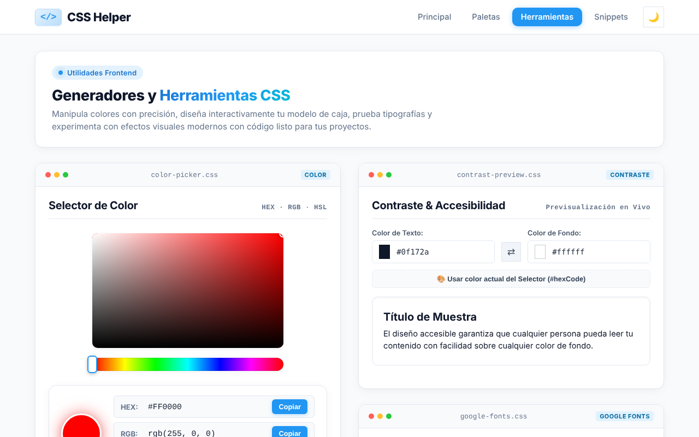
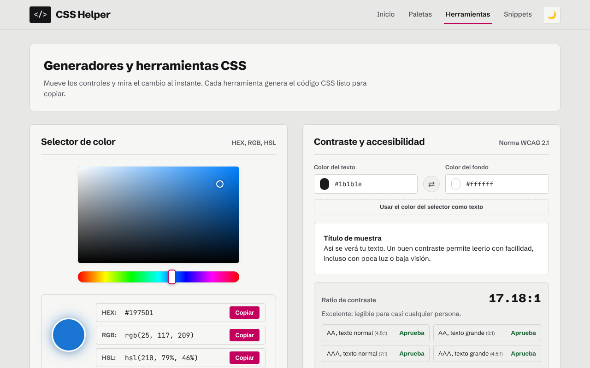

# Auditoría y rediseño de CSS Helper

- **Proyecto auditado:** [JulianPeralta26/CssHelper](https://github.com/JulianPeralta26/CssHelper), commit `0361607`.
- **Dónde están las correcciones:** en este repositorio (`edhdez1/Pruebas`), no en el de Julian.
  - El primer commit es una copia exacta del original.
  - Los siguientes contienen las correcciones, así se puede revisar cada cambio por separado.
- **Fecha:** 11 de noviembre de 2026.

---

## Resumen

La app tenía buena base, pero:

- **Cinco herramientas fallaban total o parcialmente:**
  - las fuentes no cargaban sin MySQL;
  - el contraste no se calculaba;
  - el selector de color se veía mal en modo oscuro y no se podía arrastrar con el dedo;
  - el modelo de caja tampoco respondía al dedo;
  - el glassmorphism arrancaba sin su fondo.
- **80 textos no se leían bien** por falta de contraste.
- **La portada mostraba cifras falsas.**
- **El aspecto general era el de una plantilla genérica.**

Se corrigió todo eso y se le dio una identidad visual propia. Las funciones y el contenido son los mismos.

## Cómo se revisó

| Revisión | Herramienta | Original | Ahora |
|---|---|---|---|
| Prueba automática: clic, copiar con comprobación del portapapeles, arrastrar, teclado y móvil, en modo claro y oscuro | Playwright | 47 de 58 bien | **60 de 60 bien** |
| Arrastre real con el dedo (pantalla táctil emulada) en el selector de color y en los 4 lados del modelo de caja | Playwright + eventos táctiles | 0 de 5 funcionan | **5 de 5 funcionan** |
| Accesibilidad WCAG 2.1 AA en las 4 páginas, ambos temas, con todos los desplegables y la ventana de exportar abiertos | axe-core | 110 fallos (80 de contraste) | **0 fallos** |
| Ruta con base de datos real | MariaDB 10.11 | — | funciona (detalles abajo) |
| Sintaxis | `php -l` y `node --check` | sin errores | sin errores |

**Guías usadas:**

- *frontend-design* (anthropics/skills) para el rediseño;
- *frontend-a11y* (affaan-m/ECC) para accesibilidad;
- *superpowers*: el método de entender, planificar y verificar, y la regla de *obra/superpowers* "verificar antes de afirmar".

Axe deja como "por revisar" algunos textos sobre degradados que no puede medir solo. Son las demostraciones de efectos, contenido que el usuario copia y que conserva sus colores a propósito.

---

## 1. Rediseño visual: sin aspecto de plantilla

### La idea

CSS Helper es una herramienta para **juzgar colores**. Fotógrafos e imprentas revisan el color sobre un **gris neutro de referencia**, para que nada alrededor altere su percepción. La interfaz adopta esa idea:

- **Fondo gris neutro y tinta casi negra.** Los colores del usuario se ven "de verdad".
- **Un solo color de acento:** el **magenta de proceso**, una de las tintas de imprenta.
- **Un solo elemento llamativo:** en la portada, una **barra de control de color**, como la que llevan los pliegos impresos, hecha con colores reales del catálogo.

| Token | Claro | Oscuro |
|---|---|---|
| Fondo (gris de referencia) | `#E7E7E5` | `#121214` |
| Superficie de tarjetas | `#F6F6F4` | `#1B1B1E` |
| Texto | `#151517` | `#ECECEA` |
| Texto secundario | `#55565C` | `#A3A4AA` |
| Acento (magenta de proceso) | `#C3005E` | `#FF6AAE` |

**Tipografía:** *Schibsted Grotesk* para la interfaz y *JetBrains Mono* solo para el código real. Antes se usaba la fuente del sistema y Consolas.

### Qué se eliminó por ser "típico de plantilla"

| Elemento | Por qué se quitó |
|---|---|
| Puntos rojo/amarillo/verde de "ventana de Mac" y nombre de archivo en cada tarjeta | Decoración falsa repetida 21 veces que no aporta información |
| Etiquetas en MAYÚSCULAS ("COLOR", "LAYOUT", "CHEAT SHEET"…) | Repetían el título de la tarjeta |
| Etiqueta con punto pulsante sobre cada título | Ruido visual sin contenido |
| Una palabra del título en degradado azul-turquesa | Es el rasgo más reconocible de páginas generadas, y además tenía poco contraste |
| Fila de "número grande + etiqueta" | Convertida en una frase normal: "7 herramientas, 9 paletas y 163 colores…" |
| Iconos emoji en cajitas de color | Decorativos; las ilustraciones de cada tarjeta ya explican la herramienta |
| Grises azulados "slate" (la paleta por defecto de Tailwind) | Reemplazados por grises neutros |
| Resplandores, sombras y "saltos" al pasar el ratón | Las tarjetas usan un borde fino. El menú activo pasa de "píldora" azul a un subrayado |
| Textos separados con puntos medios ("HEX · RGB · HSL") | Ahora "HEX, RGB, HSL" |





---

## 2. Errores de funcionamiento

| # | Problema | Qué veía la persona usuaria | Arreglo |
|---|---|---|---|
| 1 | **Fuentes sin MySQL** | El selector mostraba "No se encontraron fuentes" y quedaba inútil | Lista de respaldo con las 5 fuentes. Con MySQL se probó con MariaDB 10.11: lee la base (una fuente añadida a mano aparece en la lista) y funciona con bases creadas por la versión original |
| 2 | **El verificador de contraste no verificaba** | El README prometía el ratio WCAG, pero solo había una vista previa | Calcula el ratio real (por ejemplo 4.47:1) y dice si aprueba AA y AAA para texto normal y grande |
| 3 | **Círculo de color oscuro en modo oscuro** | Elegías rojo y la muestra salía azul marino | Una regla con `!important` lo pintaba; se quitó |
| 4 | **El selector pintaba la vista previa de fuentes** | "Hola Mundo" salía rojo y parecía un error | Ahora son herramientas independientes |
| 5 | **Sin pantalla táctil ni teclado** | En celular, arrastrar en el selector de color o el modelo de caja no hacía nada | Funciona con dedo, ratón y lápiz (probado). El selector de color también se mueve con las flechas del teclado |
| 6 | **Glassmorphism sin fondo al abrir** | El botón "Púrpura" aparecía activo, pero el fondo era blanco y el texto de la demo no se veía | El escenario arranca con el fondo correcto |
| 7 | **Copiar podía fallar en silencio** | Había 3 formas distintas de copiar y algunas no avisaban del error | Un único sistema, con respaldo y mensaje si no se puede copiar |
| 8 | **El backend enviaba errores internos** | Si fallaba MySQL, el navegador recibía el mensaje técnico | El detalle va al registro del servidor |
| 9 | **Variable CSS inexistente** | `--radius-full` se usaba en más de 10 reglas sin estar definida | Definida |
| 10 | **El tema se "pegaba" y parpadeaba** | La primera visita guardaba el tema del sistema como si lo hubieras elegido tú | Solo se guarda al pulsar el botón; se aplica antes de pintar la página |
| 11 | **Icono de pestaña** | No había | Añadido, con un SVG validado |

**Cambio de comportamiento (no es un error del original):** en el modelo de caja, arrastrar un borde **hacia fuera** ahora siempre lo agranda. Antes, en los bordes superior e izquierdo ocurría lo contrario.

**A tener en cuenta:** quien ya tenga la base de datos creada conserva sus filas antiguas. Las variantes cursivas nuevas de las fuentes solo llegan en una instalación nueva, o si se vacía la tabla `fonts`.

## 3. Contraste (norma WCAG 2.1: mínimo 4.5:1 para texto normal)

| Elemento | Antes | Ahora |
|---|---|---|
| Texto sobre el botón principal y el menú activo | 3.1:1 en claro y **2.1:1 en oscuro** ❌ | 6.0:1 en claro y 7.1:1 en oscuro ✅ |
| Texto gris secundario | 4.3:1 ❌ | 5.9:1 o más ✅ |
| Números del modelo de caja en modo oscuro | 2.5:1 ❌ | 9.9:1 ✅ |
| Título con degradado | ~2.3:1 en su extremo turquesa ❌ | color sólido ✅ |


## 4. Textos (copywriting)

| Antes | Ahora | Por qué |
|---|---|---|
| "4 Herramientas en vivo", "30+ Colores curados" | "7 herramientas, 9 paletas y 163 colores…" | Las cifras eran falsas; ahora se calculan solas a partir de los archivos |
| "Principal" | "Inicio" | Término habitual |
| "Selector de Fuentes" / "Buscador de Fuentes" | "Fuentes de Google" | Una herramienta con dos nombres, y sin buscador |
| "Usar color actual del Selector (#hexCode)" | "Usar el color del selector como texto" | Mostraba un nombre interno del código |
| "Reset", "Sunset", "Mesh Dark", "Drag & Drop" | "Restablecer", "Atardecer", "Oscuro", "Arrastra cada borde de color" | Sin mezclar inglés y español innecesariamente |
| "Modelo de Caja CSS", "Efectos Visuales CSS" | "Modelo de caja", "Efectos visuales" | En español, mayúscula solo al inicio |
| "Explorar Colección de Snippets" | "Ver todos los snippets" | El enlace dice exactamente qué hace |
| "No se encontraron snippets…" | "Ningún snippet coincide con tu búsqueda. Prueba con otra palabra o elige «Todos»." | Un estado vacío debe decir qué hacer a continuación |

## 5. Estructura y accesibilidad

- **Títulos:** un `<h1>` por página y jerarquía de títulos correcta. Antes, 3 de las 4 páginas no tenían título principal.
- **Formularios:** etiquetas en todos los campos y botones con nombre descriptivo para lectores de pantalla.
- **Teclado:**
  - enlace "Saltar al contenido";
  - foco visible en todos los controles;
  - los bloques de código con desplazamiento se pueden recorrer con teclado.
- **Ventana de exportar:**
  - se anuncia como diálogo;
  - lleva el foco dentro y lo mantiene ahí mientras está abierta;
  - al cerrarse, devuelve el foco al botón que la abrió.
- **Botones de alternar:** indican cuál está activo.
- **Movimiento reducido:** se respeta esa preferencia del sistema.
- **Móvil:** sin desplazamiento horizontal.

## 6. Código

- **Copiado centralizado:** `copyToClipboard()` y `bindCopyButton()` en `js/toast.js`. Antes estaba repetido en 7 archivos.
- **Estilos:** los repetidos en línea se pasaron a clases.
- **Fuentes:** la lista vive en un solo archivo, `backend/fonts_data.php`.
- **Credenciales de MySQL:** se pueden cambiar con variables de entorno.
- **Búsqueda de fuentes:** escapa los caracteres comodín `%` y `_`.
- **CSS:** todo lo añadido está al final de `styles.css`, en las secciones "AUDITORÍA" y "REDISEÑO".

## Lo que no se cambió

- **El nombre `snipets.php`** (le falta una "p"): renombrarlo rompería enlaces existentes.
- **El archivo LICENSE:** el README dice "MIT", pero el archivo no existe. Debe añadirlo el autor.
- **Las demostraciones de efectos** (neón, degradado, vidrio) conservan sus colores, porque son el código que la persona copia.

## Recomendaciones

1. **Reducir la hoja de estilos.** Tiene más de 4 000 líneas, con reglas de modo oscuro duplicadas y más de 80 `!important`. Conviene que cada componente use solo variables.
2. **Guardar las pruebas en el repositorio.** Las pruebas de esta auditoría (Playwright y axe) servirían para detectar errores antes de publicar.

## Cómo probarlo

```bash
# Desde la carpeta del proyecto (MySQL es opcional)
php -S localhost:8000
# Abre http://localhost:8000
```
